## 9. TỔNG HỢP CÁC SƠ ĐỒ THIẾT KẾ HỆ THỐNG PHÂN MẢNH (MODULAR SYSTEM DESIGN DIAGRAMS FOR REPORT)

> **Ghi chú học thuật dành cho báo cáo / đồ án:** 
> Phần này cung cấp toàn bộ các sơ đồ thiết kế hệ thống được phân mảnh chi tiết theo từng phân hệ, từng quy trình nghiệp vụ và từng mức độ trừu tượng, có đánh số thứ tự hình vẽ chuẩn hóa (`Hình 9.x: ...`) kèm mô tả kỹ thuật, sẵn sàng trích xuất và chèn trực tiếp vào các chương của Báo cáo Kỹ thuật, Khóa luận Tốt nghiệp hoặc Bài báo Khoa học.

---

### 9.1. Nhóm Sơ Đồ Kiến Trúc Hệ Thống (System Architecture Diagrams)

#### Hình 9.1.1: Sơ đồ Kiến trúc Phân tầng Tổng thể Hệ thống (High-Level Layered Architecture)
*Mô tả: Minh họa kiến trúc 4 tầng phân lập rõ ràng từ Tầng Nguồn Dữ Liệu, Tầng Lưu Trữ & Bộ Nhớ Đệm Kép, Tầng Xử Lý & Động Cơ Tính Toán, đến Tầng Ứng Dụng & Giao Diện Người Dùng.*

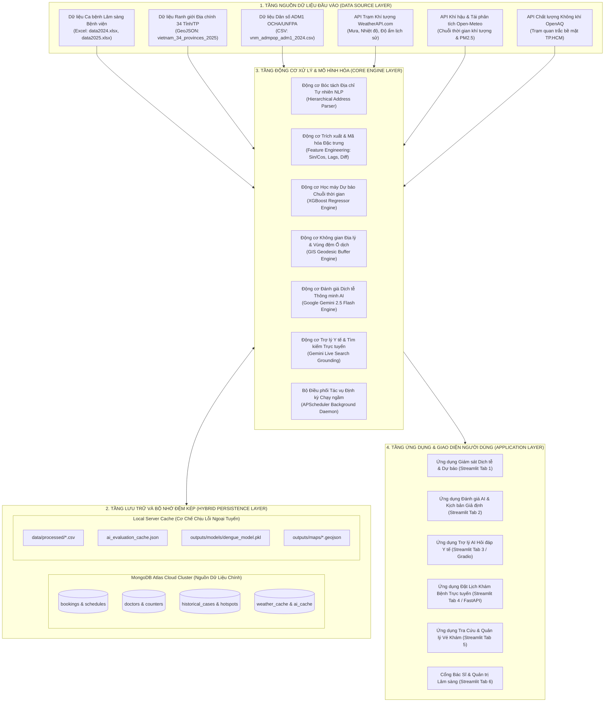

---

#### Hình 9.1.2: Kiến trúc Phân hệ Pipeline Dữ liệu & Học máy (Data & ML Pipeline Subsystem Architecture)
*Mô tả: Minh họa chi tiết luồng dữ liệu khép kín từ trích xuất tệp lâm sàng bệnh viện, tiền xử lý, gán tọa độ, đồng bộ thời tiết, huấn luyện XGBoost và sinh bản đồ GIS.*

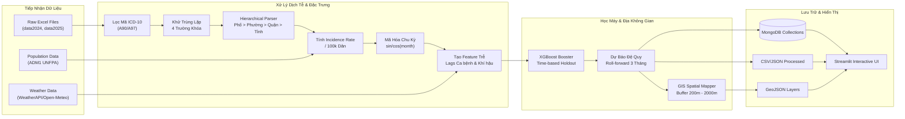

---

#### Hình 9.1.3: Kiến trúc Phân hệ Trí tuệ Nhân tạo & LLM (AI Intelligence & Chatbot Subsystem Architecture)
*Mô tả: Minh họa kiến trúc tích hợp Google GenAI SDK (Gemini 2.5/3.5) phục vụ hai nhiệm vụ song song: Đánh giá dịch tễ theo kịch bản và Trợ lý y tế trực tuyến có neo tìm kiếm (Google Search Grounding).*

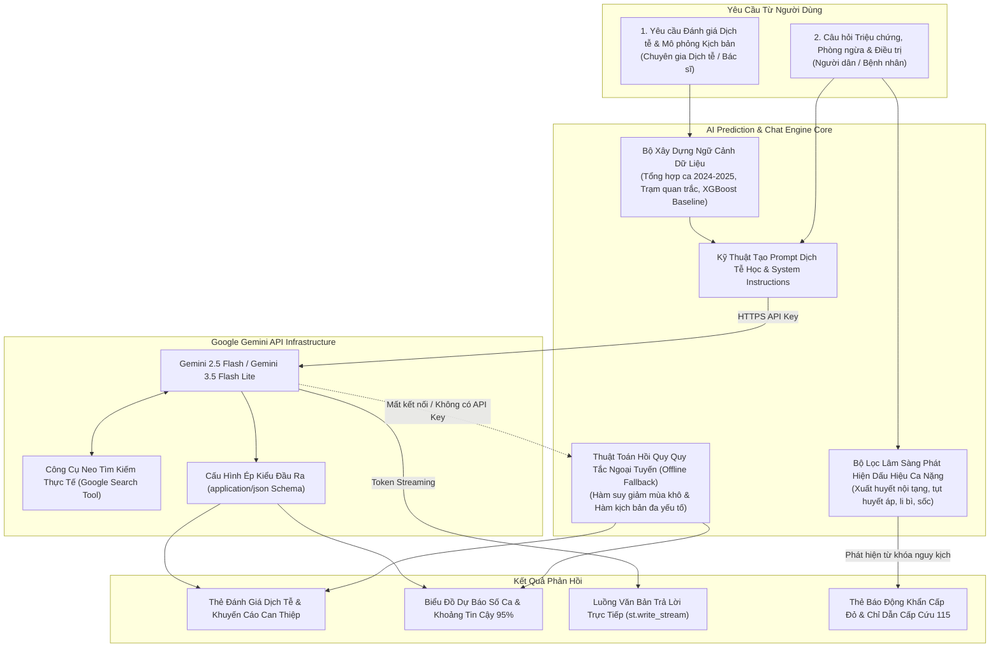

---

#### Hình 9.1.4: Kiến trúc Phân hệ Cổng Y tế & Đặt Lịch Khám Bệnh (Clinical Booking & Doctor Portal Architecture)
*Mô tả: Minh họa hệ thống đặt lịch khám chuyên khoa và phân quyền làm việc độc quyền của Bác sĩ với cơ chế mã hóa mật khẩu SHA-256 và sinh STT nguyên tử.*

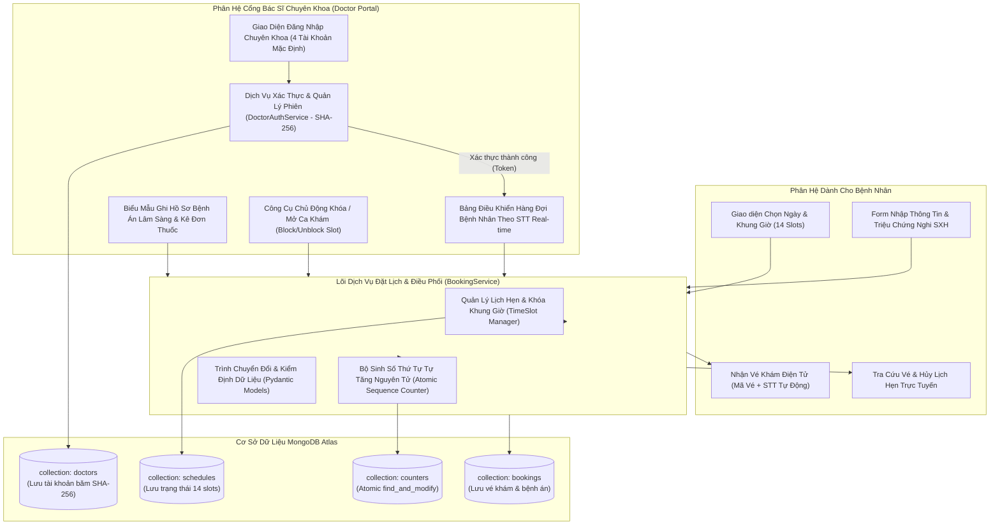

---

#### Hình 9.1.5: Kiến trúc Cơ chế Lưu trữ Kép & Chịu Lỗi Ngoại Tuyến (Dual Persistence & Fault-Tolerance Architecture)
*Mô tả: Cơ chế chuyển đổi tự động (Automatic Failover) giữa cơ sở dữ liệu đám mây MongoDB Atlas và bộ nhớ đệm cục bộ Local CSV/JSON khi gặp sự cố mạng.*

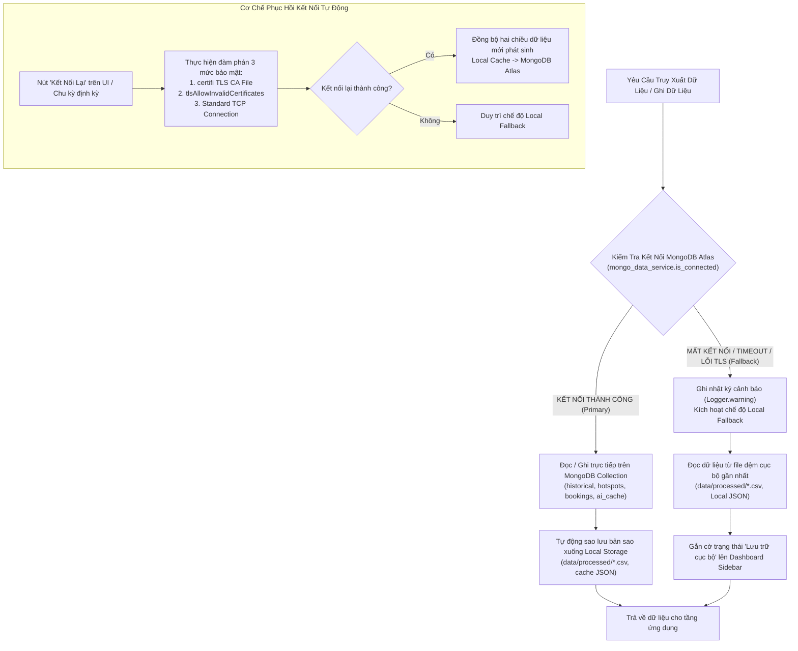

---

### 9.2. Nhóm Sơ Đồ Luồng Hoạt Động & Quy Trình Nghiệp Vụ (Process & Data Flowcharts)

#### Hình 9.2.1: Sơ đồ Luồng Tiền Xử Lý Dữ Liệu Thô & Khử Trùng Lặp (Raw Data Preprocessing & Deduplication Flow)
*Mô tả: Quy trình đọc các tệp bệnh án Excel/CSV từ bệnh viện, duyệt qua các sheet, lọc mã chẩn đoán ICD-10 và khử bệnh nhân trùng lặp qua bộ 4 trường thông tin khóa.*

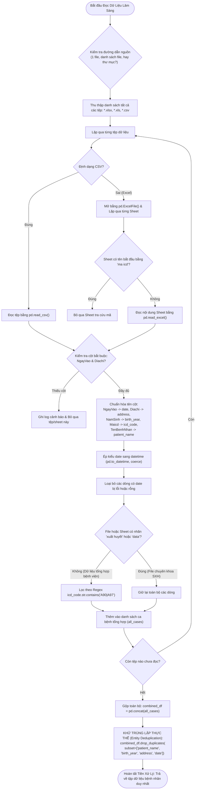

---

#### Hình 9.2.2: Sơ đồ Luồng Bóc Tách Địa Chỉ Đa Tầng Bằng NLP (Hierarchical Address Parsing Flow)
*Mô tả: Giải thuật bóc tách địa chỉ chuỗi tự nhiên sang 4 cấp độ hành chính chuẩn hóa và suy luận tọa độ địa lý tương ứng.*

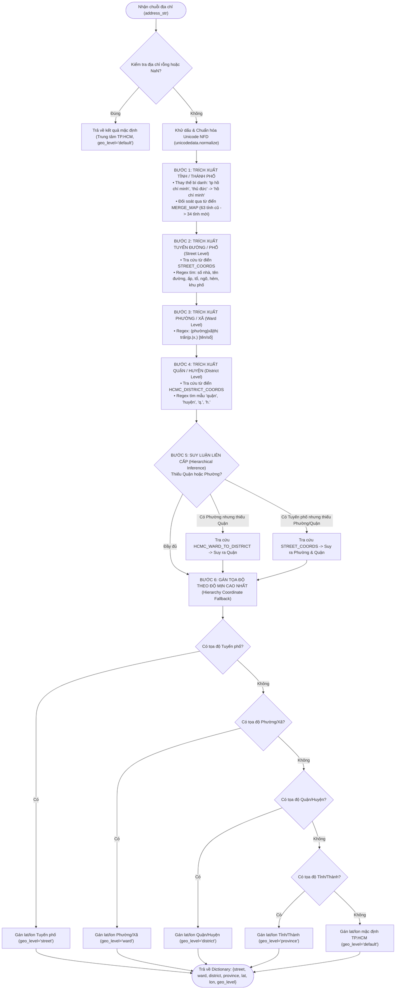

---

#### Hình 9.2.3: Sơ đồ Luồng Kỹ Thuật Đặc Trưng & Huấn Luyện Mô Hình XGBoost (Feature Engineering & ML Training Flow)
*Mô tả: Quy trình tạo đặc trưng chu kỳ lượng giác, độ trễ thời gian, phân chia tập dữ liệu Out-of-Time và huấn luyện cây quyết định tăng cường gradient.*

```mermaid
flowchart TD
    StartFE(["Bắt đầu Quy Trình Huấn Luyện (train_model)"]) --> SortDF["Sắp xếp dữ liệu theo tỉnh và thời gian: df.sort_values(['province', 'date'])"]
    
    SortDF --> Feat_Trig["1. Tạo Đặc trưng Chu kỳ Lượng giác:<br/>month_sin = sin(2 * pi * month / 12)<br/>month_cos = cos(2 * pi * month / 12)"]
    
    Feat_Trig --> Feat_Lag["2. Tạo Đặc trưng Độ trễ Ca bệnh:<br/>cases_lag_1 = shift(1) theo từng tỉnh<br/>cases_lag_2 = shift(2) theo từng tỉnh<br/>Điền khuyết bằng 0 (fillna=0)"]
    
    Feat_Lag --> Feat_Weather["3. Kiểm tra Đặc trưng Độ trễ Khí tượng:<br/>Kiểm tra rain_lag_1, temp_lag_1, humidity_lag_1 có tồn tại và khác 0?"]
    
    Feat_Weather --> DetectFeat{"Có dữ liệu thời tiết hợp lệ?"}
    DetectFeat -- "Có" --> SetActiveExtended["active_features = FEATURES_BASE + FEATURES_WEATHER (8 + 3 = 11 đặc trưng)"]
    DetectFeat -- "Không" --> SetActiveBase["active_features = FEATURES_BASE (8 đặc trưng)"]
    
    SetActiveExtended & SetActiveBase --> CastCat["Ép kiểu danh mục tỉnh thành: pd.Categorical(province, categories=province_categories)"]
    
    CastCat --> SplitData{"Kiểm tra số lượng mốc thời gian duy nhất > test_months (3 tháng)?"}
    SplitData -- "Đủ (> 3 tháng)" --> TimeSplit["TIME-BASED HOLDOUT SPLIT (Giữ trật tự thời gian):<br/>cutoff_date = unique_dates[-3]<br/>Train Set: date < cutoff_date<br/>Test Set: date >= cutoff_date"]
    SplitData -- "Không đủ (<= 3 tháng)" --> RandomSplit["RANDOM SPLIT FALLBACK:<br/>Train Set = 80%, Test Set = 20%"]
    
    TimeSplit & RandomSplit --> DMatrix["Chuyển đổi dữ liệu sang xgb.DMatrix:<br/>dtrain = xgb.DMatrix(X_train, y_train, enable_categorical=True)<br/>dtest = xgb.DMatrix(X_test, y_test, enable_categorical=True)"]
    
    DMatrix --> TrainBooster["Huấn luyện XGBoost Booster:<br/>params = {objective: 'reg:squarederror', lr: 0.05, max_depth: 4,<br/>subsample: 0.8, colsample_bytree: 0.8, seed: 42}<br/>num_boost_round = 200"]
    
    TrainBooster --> EvalMetrics["Đánh giá trên Test Set:<br/>Tính RMSE = sqrt(mean((y_true - y_pred)^2))<br/>Tính MAE = mean(abs(y_true - y_pred))"]
    
    EvalMetrics --> SaveBundle["Đóng gói Bundle bằng Joblib:<br/>bundle = {model, province_categories, active_features, metrics}<br/>Lưu vào: outputs/models/dengue_model.pkl"]
    
    SaveBundle --> EndTrain(["Hoàn thành Huấn Luyện"])
```

---

#### Hình 9.2.4: Sơ đồ Luồng Dự Báo Chuỗi Thời Gian Đa Bước Đệ Quy (Recursive Multi-Step Forecasting Flow)
*Mô tả: Thuật toán cuộn tiến thời gian dự báo số ca mắc sốt xuất huyết cho 3 tháng tương lai.*

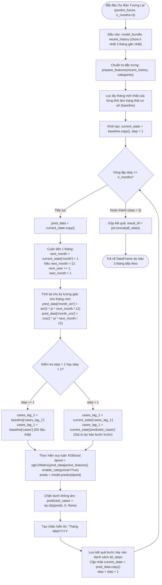

---

#### Hình 9.2.5: Sơ đồ Luồng Phân Tầng Nguy Cơ & Khoanh Vùng Đệm Geodesic Ổ Dịch (GIS Clustering & Buffer Zoning Flow)
*Mô tả: Thuật toán gom nhóm ca bệnh theo địa giới hành chính, phân loại màu sắc cảnh báo rủi ro và dựng hình học vùng đệm bán kính thực tế.*

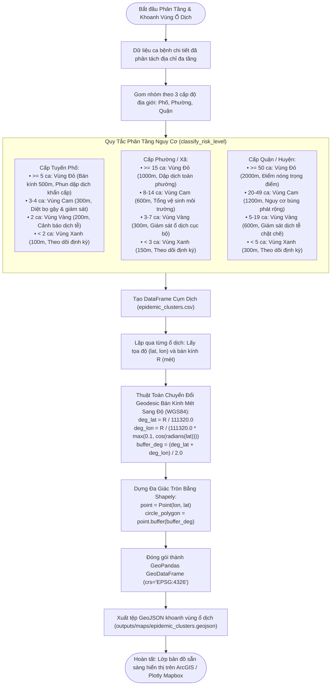

---

#### Hình 9.2.6: Sơ đồ Luồng Đánh Giá Dịch Tễ AI & Mô Phỏng Kịch Bản Giả Định (AI Scenario Simulation Flow)
*Mô tả: Quy trình tiếp nhận kịch bản giả định (Lượng mưa, Độ ẩm, Chỉ số bọ gậy BI, Nỗ lực can thiệp), phân tích ngữ cảnh và trả về dự báo có cấu trúc JSON.*

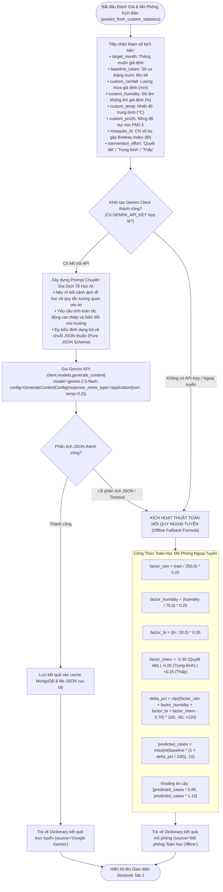

---

#### Hình 9.2.7: Sơ đồ Luồng Trợ Lý Y Tế AI & Bộ Lọc Ca Bệnh Nguy Kịch (Medical Assistant & Emergency Detection Flow)
*Mô tả: Cơ chế tiếp nhận câu hỏi của người dân, kích hoạt tìm kiếm thời gian thực Google Search Grounding và nhận diện các dấu hiệu sốt xuất huyết nặng.*

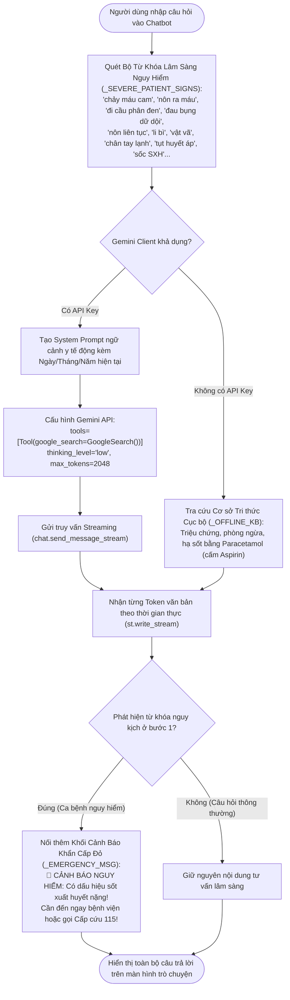

---

#### Hình 9.2.8: Sơ đồ Luồng Bệnh Nhân Đặt Lịch Khám & Cấp STT Nguyên Tử (Patient Booking & Atomic Queue STT Flow)
*Mô tả: Quy trình bảo đảm an toàn giao dịch khi đặt chỗ, ngăn ngừa tranh chấp ca khám và cấp số thứ tự liên tục theo ngày.*

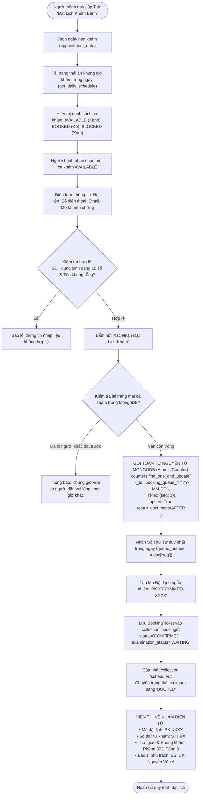

---

#### Hình 9.2.9: Sơ đồ Luồng Bác Sĩ Thăm Khám & Ghi Hồ Sơ Bệnh Án Điện Tử (Doctor Consultation & Clinical Record Flow)
*Mô tả: Quy trình nghiệp vụ lâm sàng độc quyền của Bác sĩ: tiếp nhận bệnh nhân theo hàng đợi STT, cập nhật tiến độ và lưu trữ bệnh án.*

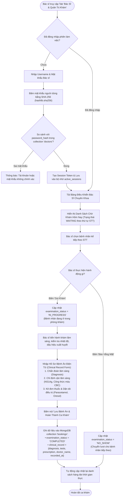

---

### 9.3. Nhóm Sơ Đồ Ca Sử Dụng (Use Case Diagrams)

#### Hình 9.3.1: Sơ đồ Ca Sử Dụng - Phân Hệ Người Dân / Bệnh Nhân (Patient / Citizen Use Cases)
*Mô tả: Tập hợp các chức năng mà người dân hoặc bệnh nhân có thể tương tác trên hệ thống.*

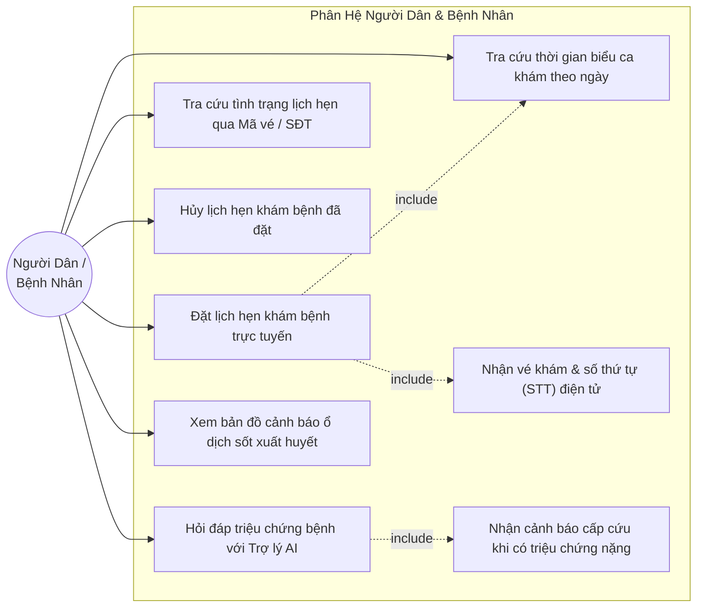

---

#### Hình 9.3.2: Sơ đồ Ca Sử Dụng - Phân Hệ Bác Sĩ Chuyên Khoa (Specialist Doctor Use Cases)
*Mô tả: Tập hợp các quyền năng và nghiệp vụ độc quyền dành cho nhân viên y tế và bác sĩ điều trị.*

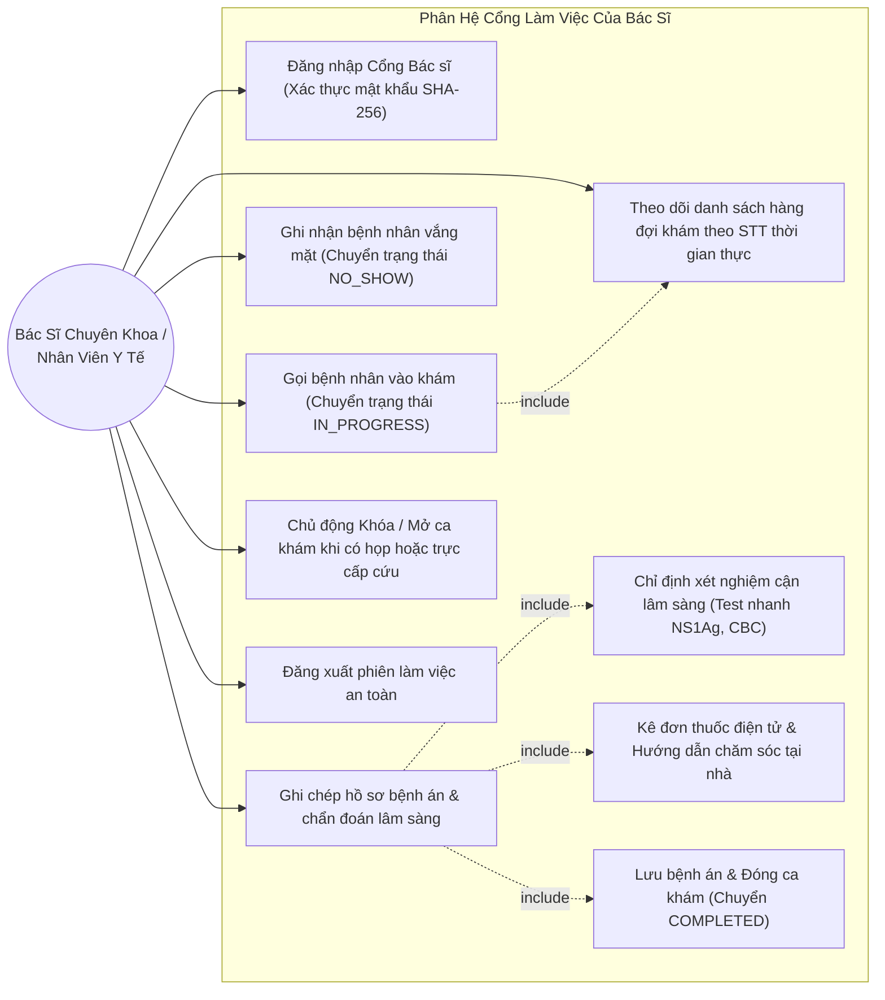

---

#### Hình 9.3.3: Sơ đồ Ca Sử Dụng - Phân Hệ Giám Sát Dịch Tễ & Nhà Quản Lý (Epidemiologist & Health Officer Use Cases)
*Mô tả: Các tác vụ phân tích, dự báo và mô phỏng chính sách y tế dự phòng dành cho cán bộ dịch tễ.*

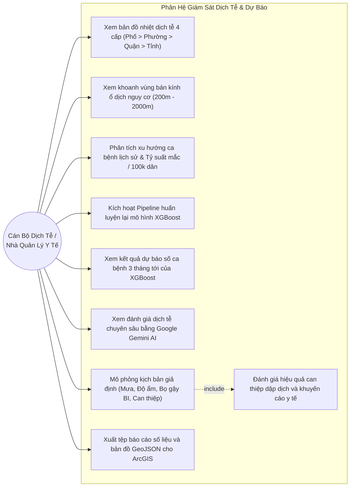

---

#### Hình 9.3.4: Sơ đồ Ca Sử Dụng - Phân Hệ Tác Vụ Nền Tự Động Hóa (System Scheduler Use Cases)
*Mô tả: Các tiến trình chạy ngầm định kỳ đảm bảo tính tươi mới và tính toàn vẹn của dữ liệu hệ thống.*

```mermaid
flowchart LR
    Actor_Daemon((Tiến Trình Chạy Ngầm /<br/>APScheduler Daemon))

    subgraph UC_DaemonModule ["Phân Hệ Tự Động Hóa Hệ Thống"]
        UC_A1["Đồng bộ nhanh thời tiết TP.HCM (Thứ Hai hàng tuần lúc 02:00)"]
        UC_A2["Đồng bộ toàn diện khí tượng 34 tỉnh/thành (Ngày 1 hàng tháng lúc 03:00)"]
        UC_A3["Tự động chuyển đổi Fallback khi WeatherAPI hết hạn mức sang Open-Meteo"]
        UC_A4["Sao lưu định kỳ dữ liệu từ Local CSV lên MongoDB Atlas"]
        UC_A5["Kiểm tra trạng thái kết nối mạng & Duy trì bộ đệm an toàn"]
    end

    Actor_Daemon --> UC_A1
    Actor_Daemon --> UC_A2
    Actor_Daemon --> UC_A3
    Actor_Daemon --> UC_A4
    Actor_Daemon --> UC_A5
```

---

### 9.4. Nhóm Sơ Đồ Lớp Phần Mềm Chi Tiết (Detailed Class Diagrams)

#### Hình 9.4.1: Sơ đồ Lớp - Tầng Truy Cập Dữ Liệu & Quản Lý MongoDB (Data Access Layer Class Diagram)
*Mô tả: Cấu trúc chi tiết của các lớp quản lý kết nối và thao tác lưu trữ dữ liệu MongoDB.*

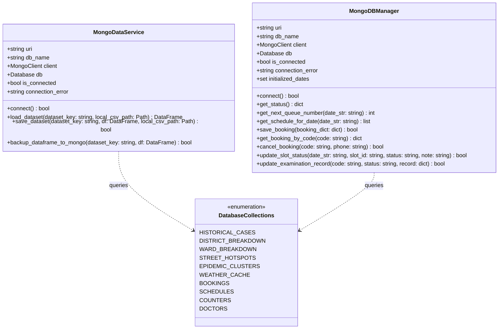

---

#### Hình 9.4.2: Sơ đồ Lớp - Phân Hệ Đặt Lịch & Xác Thực Bác Sĩ (Clinical Booking & Doctor Auth Class Diagram)
*Mô tả: Thiết kế hướng đối tượng của dịch vụ điều phối ca khám, xác thực bác sĩ và các mô hình dữ liệu Pydantic.*

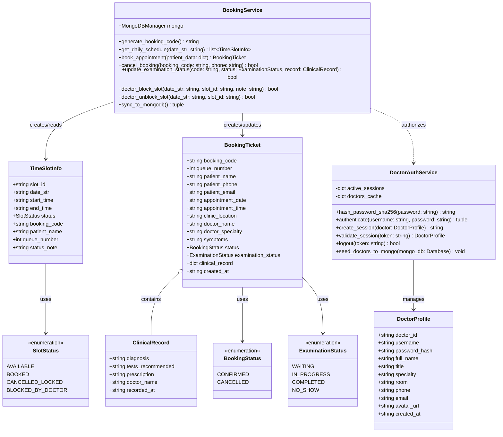

---

#### Hình 9.4.3: Sơ đồ Lớp - Phân Hệ Trí Tuệ Nhân Tạo & Chatbot (AI & Chatbot Class Diagram)
*Mô tả: Thiết kế các lớp phụ trách kết nối LLM, xây dựng prompt dịch tễ học và xử lý luồng câu hỏi.*

```mermaid
classDiagram
    class GeminiChatEngine {
        +string api_key
        +string model_name
        +Client genai_client
        +process_query_stream(query: string, role: string, history: list) Generator
        +process_query(query: string, role: string, history: list) dict
        -_get_system_prompt(role: string) string
        -_offline_answer(query: string) string
        -_build_history(chat_history: list) list
    }

    class AIPredictionService {
        +Client client
        +Path cache_file
        +load_cached_existing_prediction() dict
        +save_cached_existing_prediction(data: dict) void
        +get_current_dengue_weather_context(province: string) dict
        +predict_from_existing_data(province: string, force_refresh: bool) dict
        +predict_from_custom_statistics(scenario: dict) dict
        -_fallback_existing_prediction(ctx: dict) dict
        -_fallback_custom_prediction(scenario: dict) dict
    }

    class ChatResponse {
        +string answer
        +string intent
        +list sources
        +int tokens_used
        +bool is_emergency
        +bool web_searched
    }

    class ScenarioSimulationResult {
        +string scenario_name
        +int predicted_cases
        +int lower_bound
        +int upper_bound
        +int delta_cases_from_baseline
        +float delta_pct_from_baseline
        +string risk_level
        +string epidemiological_assessment
        +string climate_vector_synergy
        +string intervention_effectiveness
        +list recommended_actions
    }

    GeminiChatEngine ..> ChatResponse : returns
    AIPredictionService ..> ScenarioSimulationResult : returns
```

---

#### Hình 9.4.4: Sơ đồ Lớp - Phân Hệ Tiền Xử Lý, Học Máy & Địa Lý GIS (Data Processor, ML & GIS Class Diagram)
*Mô tả: Thiết kế các module xử lý dữ liệu lâm sàng, thuật toán học máy XGBoost và công cụ tạo GeoJSON.*

```mermaid
classDiagram
    class DataProcessor {
        +dict MERGE_MAP
        +dict VN_PROVINCE_COORDS
        +dict HCMC_DISTRICT_COORDS
        +dict HCMC_WARD_TO_DISTRICT
        +dict STREET_COORDS
        +extract_province(address_str: string) string
        +parse_hierarchical_address(address_str: string) dict
        +classify_risk_level(cases: int, level: string) tuple
        +generate_epidemic_clusters(df_cases: DataFrame) DataFrame
        +process_patient_data(source_path: Path) tuple
        +load_population_data(pop_file: Path) DataFrame
        +load_and_process_new_data(patient_file: Path, pop_file: Path) DataFrame
        +merge_weather_features(df_cases: DataFrame, df_weather: DataFrame) DataFrame
    }

    class XGBoostModel {
        +list FEATURES_BASE
        +list FEATURES_WEATHER
        +_get_active_features(df: DataFrame) list
        +prepare_features(data: DataFrame, province_categories: list) DataFrame
        +train_model(historical_data: DataFrame, model_path: Path, test_months: int) dict
        +predict_future(model_bundle: dict, recent_history: DataFrame, n_months: int) DataFrame
    }

    class GISMapper {
        +create_map_data(agg_data: DataFrame, boundary_file: Path, output_file: Path) GeoDataFrame
        +create_cluster_geojson(clusters_df: DataFrame, output_file: Path) GeoDataFrame
    }

    class WeatherService {
        +string WEATHERAPI_KEY
        +dict PROVINCE_COORDS
        +BackgroundScheduler scheduler
        +fetch_province_weather(province: string, start_year: int, end_year: int) DataFrame
        +fetch_all_provinces_weather(provinces: list) DataFrame
        +load_weather_cache() DataFrame
        +save_weather_cache(df: DataFrame) void
        +sync_weather_delta(provinces: list, force_refresh: bool) DataFrame
        +sync_hcmc_weekly() DataFrame
        +start_weather_scheduler() void
        +stop_weather_scheduler() void
    }

    DataProcessor --> GISMapper : supplies_data
    XGBoostModel --> GISMapper : supplies_predictions
    WeatherService --> DataProcessor : supplies_weather_lags
```

---

### 9.5. Nhóm Sơ Đồ Thực Thể - Quan Hệ Theo Miền Nghiệp Vụ (Segmented Domain ERD)

#### Hình 9.5.1: Sơ đồ ERD - Miền Nghiệp Vụ Khám Chữa Bệnh & Quản Lý Phòng Khám (Clinical & Booking Domain)
*Mô tả: Cấu trúc thực thể và quan hệ giữa vé khám, lịch trình làm việc, tài khoản bác sĩ và bộ đếm số thứ tự.*

```mermaid
erDiagram
    DOCTORS ||--o{ BOOKINGS : "phu_trach_kham"
    BOOKINGS ||--|| SCHEDULES : "chiem_giu_khung_gio"
    BOOKINGS ||--o| CLINICAL_RECORDS : "chua_thong_tin_benh_an"
    COUNTERS ||--o{ BOOKINGS : "sinh_stt_theo_ngay"

    DOCTORS {
        string doctor_id PK "Mã định danh Bác sĩ (doc_01..04)"
        string username UK "Tên đăng nhập hệ thống"
        string password_hash "Mật khẩu mã hóa SHA-256"
        string full_name "Họ và tên bác sĩ"
        string title "Học hàm học vị (BS. CKI, ThS)"
        string specialty "Chuyên khoa điều trị"
        string room "Phòng khám lâm sàng"
        string phone "Số điện thoại liên lạc"
        string email "Email nội bộ bệnh viện"
        string avatar_url "Ảnh chân dung bác sĩ"
        string created_at "Thời điểm tạo tài khoản"
    }

    BOOKINGS {
        string booking_code PK "Mã vé khám (BK-YYYYMMDD-XXXX)"
        int queue_number "Số thứ tự khám trong ngày (1, 2, 3...)"
        string patient_name "Họ tên người bệnh"
        string patient_phone "Số điện thoại liên hệ"
        string patient_email "Địa chỉ email (tùy chọn)"
        string appointment_date "Ngày hẹn khám (YYYY-MM-DD)"
        string appointment_time "Giờ hẹn (VD: 08:00 - 08:30)"
        string clinic_location "Địa điểm phòng khám"
        string doctor_name "Bác sĩ phụ trách khám"
        string doctor_specialty "Chuyên khoa"
        string symptoms "Mô tả triệu chứng bệnh nhân nhập"
        string status "CONFIRMED | CANCELLED"
        string examination_status "WAITING | IN_PROGRESS | COMPLETED | NO_SHOW"
        string created_at "Thời điểm đặt vé (ISO Timestamp)"
    }

    SCHEDULES {
        string slot_id PK "Mã khung giờ (VD: slot_0800_0830)"
        string date_str "Ngày khám (YYYY-MM-DD)"
        string start_time "Giờ bắt đầu (08:00)"
        string end_time "Giờ kết thúc (08:30)"
        string status "AVAILABLE | BOOKED | BLOCKED_BY_DOCTOR"
        string booking_code FK "Mã vé chiếm chỗ (nếu có)"
        string patient_name "Tên bệnh nhân giữ chỗ"
        int queue_number "Số thứ tự giữ chỗ"
        string status_note "Ghi chú (Lý do bác sĩ khóa ca...)"
    }

    CLINICAL_RECORDS {
        string record_id PK "Mã định danh bệnh án điện tử"
        string booking_code FK "Mã vé khám liên kết"
        string diagnosis "Chẩn đoán chuyên môn của bác sĩ"
        string tests_recommended "Chỉ định xét nghiệm (NS1Ag, CBC)"
        string prescription "Đơn thuốc & Liều dùng (Paracetamol...)"
        string doctor_name "Tên bác sĩ ký xác nhận"
        string recorded_at "Thời điểm lưu bệnh án"
    }

    COUNTERS {
        string id PK "Khóa chính (booking_queue_YYYY-MM-DD)"
        string date UK "Ngày đếm số thứ tự"
        int seq "Giá trị số thứ tự tăng nguyên tử hiện tại"
    }
```

---

#### Hình 9.5.2: Sơ đồ ERD - Miền Nghiệp Vụ Dịch Tễ Học & Không Gian Địa Lý (Epidemiology & Geospatial Domain)
*Mô tả: Mô hình quan hệ không gian đa tầng giữa Tỉnh/Thành, Quận/Huyện, Phường/Xã, Tuyến đường với dữ liệu ca bệnh lâm sàng và các đa giác khoanh vùng ổ dịch.*

```mermaid
erDiagram
    PROVINCES ||--o{ DISTRICTS : "quan_ly_hanh_chinh"
    DISTRICTS ||--o{ WARDS : "quan_ly_hanh_chinh"
    WARDS ||--o{ STREETS : "chua_tuyen_pho"
    
    PROVINCES ||--o{ HISTORICAL_CASES : "thong_ke_ca_tinh"
    DISTRICTS ||--o{ DISTRICT_CASES : "thong_ke_ca_quan"
    WARDS ||--o{ WARD_CASES : "thong_ke_ca_phuong"
    STREETS ||--o{ STREET_HOTSPOTS : "thong_ke_ca_duong"
    
    PROVINCES ||--o{ EPIDEMIC_CLUSTERS : "co_cum_dich"

    PROVINCES {
        string province_name PK "Tên tỉnh/thành phố (34 tỉnh chuẩn hóa)"
        float default_lat "Vĩ độ trung tâm"
        float default_lon "Kinh độ trung tâm"
        float population "Dân số toàn tỉnh (người)"
    }

    DISTRICTS {
        string district_name PK "Tên quận/huyện"
        string province_name FK "Tỉnh/thành phố trực thuộc"
        float lat "Vĩ độ trung tâm quận"
        float lon "Kinh độ trung tâm quận"
    }

    WARDS {
        string ward_name PK "Tên phường/xã/thị trấn"
        string district_name FK "Quận/huyện trực thuộc"
        float lat "Vĩ độ phường"
        float lon "Kinh độ phường"
    }

    STREETS {
        string street_name PK "Tên đường/phố/ấp"
        string ward_name FK "Phường/xã trực thuộc"
        float lat "Vĩ độ điểm nóng tuyến phố"
        float lon "Kinh độ điểm nóng tuyến phố"
    }

    HISTORICAL_CASES {
        string id PK "Mã bản ghi ca bệnh tỉnh"
        string province FK "Tên tỉnh/thành phố"
        datetime date "Thời điểm báo cáo (cuối tháng)"
        int year "Năm"
        int month "Tháng"
        int cases "Tổng số ca bệnh trong tháng"
        float population "Dân số tỉnh"
        float incidence_rate "Tỷ suất mắc / 100k dân"
    }

    EPIDEMIC_CLUSTERS {
        string cluster_id PK "Mã cụm dịch (ST_xxx, WD_xxx, DT_xxx)"
        string name "Tên gọi vùng ổ dịch"
        string level "Phố | Phường | Quận"
        string province FK "Tỉnh/thành"
        string district "Quận/huyện"
        string ward "Phường/xã"
        string street "Tuyến phố"
        datetime date "Tháng phát hiện ổ dịch"
        int cases "Số ca nhiễm ghi nhận"
        string risk_level "Vùng Đỏ | Vùng Cam | Vùng Vàng | Vùng Xanh"
        string risk_color "Mã màu hex cảnh báo (#d90429...)"
        float radius_meters "Bán kính khoanh vùng dập dịch (mét)"
        string recommendation "Biện pháp can thiệp y tế khuyến cáo"
        float lat "Tọa độ tâm ổ dịch (Vĩ độ)"
        float lon "Tọa độ tâm ổ dịch (Kinh độ)"
    }
```

---

#### Hình 9.5.3: Sơ đồ ERD - Miền Nghiệp Vụ Khí Tượng Trạm Quan Trắc & Môi Trường (Meteorology & Environment Domain)
*Mô tả: Mô hình lưu trữ dữ liệu thời tiết và chất lượng không khí thu thập từ các trạm quan trắc địa phương và vệ tinh tái phân tích.*

```mermaid
erDiagram
    PROVINCES ||--o{ WEATHER_MONTHLY : "so_lieu_thoi_tiet_thang"
    PROVINCES ||--o{ WEATHER_HOURLY : "so_lieu_chuoi_gio"
    WEATHER_MONTHLY ||--o| AI_EVALUATION_CACHE : "lam_ngu_canh_ai"

    PROVINCES {
        string province_name PK "Tên tỉnh/thành"
        string ascii_key "Khóa không dấu tra cứu API"
        string wapi_query "Chuỗi truy vấn WeatherAPI"
        float lat "Vĩ độ trạm quan trắc"
        float lon "Kinh độ trạm quan trắc"
    }

    WEATHER_MONTHLY {
        string id PK "Mã tổng hợp tháng (Prov_YYYY_MM)"
        string province FK "Tên tỉnh/thành"
        int year "Năm quan trắc"
        int month "Tháng quan trắc"
        float precipitation_sum "Tổng lượng mưa trong tháng (mm)"
        float temp_mean "Nhiệt độ không khí trung bình (°C)"
        float humidity_mean "Độ ẩm tương đối trung bình (%)"
        float pm25_mean "Nồng độ bụi mịn PM2.5 trung bình (µg/m³)"
    }

    WEATHER_HOURLY {
        string id PK "Mã bản ghi giờ (Timestamp)"
        datetime time "Thời điểm đo (UTC+7)"
        float temperature "Nhiệt độ mặt đất (°C)"
        float humidity "Độ ẩm tương đối (%)"
        float wind_speed "Tốc độ gió (km/h)"
        float pressure "Áp suất khí quyển (hPa)"
        float precipitation "Lượng mưa tích lũy giờ (mm)"
        float pm25_raw "PM2.5 thực tế đo được (µg/m³)"
        boolean pm25_interpolated "Cờ đánh dấu nội suy"
        int n_obs "Số trạm quan trắc hợp lệ trong giờ"
    }

    AI_EVALUATION_CACHE {
        string key PK "'existing_data_eval' hoặc 'scenario_eval'"
        dict data "Dữ liệu JSON đánh giá dịch tễ & dự báo"
        string updated_at "Thời điểm cập nhật bản ghi"
    }
```

---

### 9.6. Nhóm Sơ Đồ Trình Tự Chi Tiết (Detailed Sequence Diagrams)

#### Hình 9.6.1: Sơ đồ Trình tự - Bệnh Nhân Đặt Lịch Hẹn & Cấp Số Thứ Tự Nguyên Tử (Patient Booking & Atomic Queue STT)
*Mô tả: Chi tiết các bước tương tác giữa Bệnh nhân, Giao diện Web, BookingService và MongoDB khi thực hiện một giao dịch đặt lịch khám.*

```mermaid
sequenceDiagram
    autonumber
    actor Patient as Bệnh Nhân (Patient)
    participant UI as Giao Diện Web (Streamlit Tab 4)
    participant Service as BookingService
    participant DB as MongoDB Manager
    participant CountersColl as Collection 'counters'
    participant BookingsColl as Collection 'bookings'
    participant SchedulesColl as Collection 'schedules'

    Patient->>UI: Chọn ngày hẹn khám (VD: 2026-11-15)
    UI->>Service: get_daily_schedule("2026-11-15")
    Service->>DB: get_schedule_for_date("2026-11-15")
    DB->>SchedulesColl: find({"date_str": "2026-11-15"})
    SchedulesColl-->>DB: Trả về danh sách 14 slots
    DB-->>Service: Danh sách TimeSlotInfo
    Service-->>UI: Hiển thị bảng lưới 14 ca khám kèm trạng thái

    Patient->>UI: Chọn ca "09:00 - 09:30" (slot_0900_0930)
    Patient->>UI: Nhập Họ tên, SĐT, Triệu chứng -> Bấm "Xác Nhận Đặt Lịch"
    UI->>Service: book_appointment(ticket_data)
    
    Service->>DB: get_next_queue_number("2026-11-15")
    DB->>CountersColl: find_one_and_update(<br/>{"_id": "booking_queue_2026-11-15"},<br/>{"$inc": {"seq": 1}}, upsert=True, return_document=AFTER)
    CountersColl-->>DB: Trả về document: {"seq": 5}
    DB-->>Service: queue_number = 5

    Service->>Service: Sinh mã vé: booking_code = "BK-20261115-A1B2"
    Service->>DB: save_booking(ticket_dict)
    DB->>BookingsColl: insert_one(ticket_dict)
    BookingsColl-->>DB: Acknowledged = True

    Service->>DB: update_slot_status("2026-11-15", "slot_0900_0930", "BOOKED")
    DB->>SchedulesColl: update_one({"date_str": "...", "slot_id": "..."}, {"$set": {"status": "BOOKED", "booking_code": "BK-20261115-A1B2"}})
    SchedulesColl-->>DB: ModifiedCount = 1

    Service-->>UI: Trả về đối tượng BookingTicket hoàn chỉnh
    UI-->>Patient: Hiển thị Thẻ Vé Khám Điện Tử (STT #5, Mã BK-20261115-A1B2)
```

---

#### Hình 9.6.2: Sơ đồ Trình tự - Bệnh Nhân Tra Cứu Vé & Hủy Lịch Hẹn (Ticket Lookup & Cancellation)
*Mô tả: Trình tự xác minh quyền sở hữu vé qua số điện thoại và mở lại khung giờ cho người bệnh khác khi có yêu cầu hủy lịch.*

```mermaid
sequenceDiagram
    autonumber
    actor Patient as Bệnh Nhân (Patient)
    participant UI as Giao Diện Tra Cứu (Streamlit Tab 5)
    participant Service as BookingService
    participant DB as MongoDB Manager
    participant BookingsColl as Collection 'bookings'
    participant SchedulesColl as Collection 'schedules'

    Patient->>UI: Nhập Mã vé (BK-20261115-A1B2) và Số điện thoại (0903123456)
    UI->>Service: cancel_booking("BK-20261115-A1B2", "0903123456")
    Service->>DB: get_booking_by_code("BK-20261115-A1B2")
    DB->>BookingsColl: find_one({"booking_code": "BK-20261115-A1B2"})
    BookingsColl-->>DB: Trả về thông tin vé khám

    alt Không tìm thấy vé hoặc sai Số điện thoại
        DB-->>Service: None hoặc SĐT không khớp
        Service-->>UI: Trả về False
        UI-->>Patient: Thông báo lỗi: Mã vé hoặc Số điện thoại không chính xác
    else Vé hợp lệ và đúng Số điện thoại
        Service->>DB: Cập nhật vé khám: status = 'CANCELLED'
        DB->>BookingsColl: update_one({"booking_code": "..."}, {"$set": {"status": "CANCELLED"}})
        BookingsColl-->>DB: ModifiedCount = 1

        Service->>DB: Mở lại khung giờ khám: status = 'AVAILABLE'
        DB->>SchedulesColl: update_one({"booking_code": "..."}, {"$set": {"status": "AVAILABLE", "booking_code": None, "patient_name": None}})
        SchedulesColl-->>DB: ModifiedCount = 1

        Service-->>UI: Trả về True
        UI-->>Patient: Thông báo: Hủy lịch hẹn thành công! Khung giờ đã được mở lại cho bệnh nhân khác.
    end
```

---

#### Hình 9.6.3: Sơ đồ Trình tự - Bác Sĩ Đăng Nhập Bảo Mật SHA-256 & Khám Bệnh Theo STT (Doctor Login & Examination Flow)
*Mô tả: Trình tự kiểm tra băm mật khẩu, cấp phiên làm việc an toàn, gọi khám và hoàn tất bệnh án.*

```mermaid
sequenceDiagram
    autonumber
    actor Doctor as Bác Sĩ Chuyên Khoa
    participant UI as Cổng Bác Sĩ (Streamlit Tab 6)
    participant AuthService as DoctorAuthService
    participant BookingService as BookingService
    participant DB as MongoDB Manager
    participant DoctorsColl as Collection 'doctors'
    participant BookingsColl as Collection 'bookings'

    Doctor->>UI: Nhập Username ("bs_nguyenvana") & Mật khẩu ("Bacsi@123")
    UI->>AuthService: authenticate("bs_nguyenvana", "Bacsi@123")
    AuthService->>AuthService: băm SHA-256: hash_password_sha256("Bacsi@123")
    AuthService->>DB: Tìm bác sĩ trong collection 'doctors'
    DB->>DoctorsColl: find_one({"username": "bs_nguyenvana"})
    DoctorsColl-->>DB: Trả về record bác sĩ kèm password_hash
    DB-->>AuthService: DoctorProfile

    alt Mật khẩu băm không khớp
        AuthService-->>UI: (False, "Mật khẩu không chính xác", None)
        UI-->>Doctor: Hiển thị thông báo đăng nhập thất bại
    else Xác thực thành công
        AuthService->>AuthService: Tạo session token: uuid4()
        AuthService-->>UI: (True, "Đăng nhập thành công", token)
        UI->>BookingService: Lấy danh sách bệnh nhân chờ khám hôm nay
        BookingService->>DB: find({"appointment_date": "hôm nay", "status": "CONFIRMED"})
        DB-->>BookingService: Danh sách vé khám
        BookingService-->>UI: Hiển thị bảng hàng đợi theo thứ tự STT

        Doctor->>UI: Bấm nút "Khám" bệnh nhân STT #1
        UI->>BookingService: update_examination_status("BK-XXXX", "IN_PROGRESS")
        BookingService->>DB: update_one({"booking_code": "BK-XXXX"}, {"$set": {"examination_status": "IN_PROGRESS"}})
        DB-->>BookingService: OK
        UI-->>Doctor: Trạng thái ca khám chuyển sang ĐANG KHÁM

        Doctor->>UI: Nhập chẩn đoán, xét nghiệm chỉ định, đơn thuốc -> Bấm "Lưu Bệnh Án"
        UI->>BookingService: update_examination_status("BK-XXXX", "COMPLETED", clinical_record)
        BookingService->>DB: update_one({"booking_code": "BK-XXXX"}, {"$set": {"examination_status": "COMPLETED", "clinical_record": record}})
        DB-->>BookingService: OK
        UI-->>Doctor: Thông báo hoàn tất ca khám & Bệnh án đã được lưu trữ vĩnh viễn
    end
```

---

#### Hình 9.6.4: Sơ đồ Trình tự - Đánh Giá Dịch Tễ Học Bằng Google Gemini AI (AI Epidemiological Evaluation)
*Mô tả: Trình tự tổng hợp ngữ cảnh lịch sử, trạm quan trắc, dự báo nền XGBoost và gọi Gemini AI sinh báo cáo JSON.*

```mermaid
sequenceDiagram
    autonumber
    actor Officer as Cán Bộ Dịch Tễ / Bác Sĩ
    participant Dashboard as Streamlit Dashboard (Tab 2)
    participant AIService as AIPredictionService
    participant MongoService as MongoDataService
    participant GeminiAPI as Google GenAI SDK (gemini-2.5-flash)

    Officer->>Dashboard: Mở Tab "AI Dự Báo & Đánh Giá Dịch Tễ"
    Dashboard->>AIService: predict_from_existing_data("TP. Hồ Chí Minh", force_refresh=False)
    
    AIService->>AIService: Kiểm tra bộ nhớ đệm (load_cached_existing_prediction)
    alt Đã có bản cache hợp lệ trong ngày
        AIService-->>Dashboard: Trả về kết quả từ Cache ngay lập tức
    else Chưa có cache hoặc force_refresh=True
        AIService->>AIService: get_current_dengue_weather_context("TP. Hồ Chí Minh")
        AIService->>MongoService: Tải số ca bệnh 2024, 2025 từ collection 'historical_cases'
        MongoService-->>AIService: Dữ liệu ca bệnh thực tế 2 năm
        AIService->>MongoService: Tải dữ liệu khí tượng & PM2.5 từ 'weatherdata_hcmc_monthly'
        MongoService-->>AIService: Dữ liệu trạm quan trắc địa phương
        AIService->>MongoService: Tải dự báo nền từ 'latest_predictions'
        MongoService-->>AIService: Dự báo baseline của XGBoost

        AIService->>AIService: Xây dựng Prompt dịch tễ học chuyên sâu kèm ngữ cảnh số liệu
        AIService->>GeminiAPI: client.models.generate_content(<br/>model='gemini-2.5-flash', contents=prompt,<br/>config=GenerateContentConfig(response_mime_type='application/json', temp=0.2))
        
        alt Gemini API phản hồi thành công
            GeminiAPI-->>AIService: Chuỗi JSON cấu trúc: {evaluation_title, risk_level, monthly_predictions, recommendations}
            AIService->>AIService: save_cached_existing_prediction(data)
            AIService-->>Dashboard: Trả về Dictionary kết quả AI
        else Gọi API thất bại / Mất kết nối mạng
            AIService->>AIService: Kích hoạt _fallback_existing_prediction(ctx)
            AIService-->>Dashboard: Trả về kết quả phân tích theo quy tắc ngoại tuyến
        end
    end

    Dashboard-->>Officer: Hiển thị Thẻ đánh giá, Khuyến cáo y tế & Biểu đồ dự báo so sánh
```

---

#### Hình 9.6.5: Sơ đồ Trình tự - Mô Phỏng Kịch Bản Giả Định Can Thiệp Dập Dịch (AI Custom Scenario Simulation)
*Mô tả: Tương tác mô phỏng tác động khi thay đổi lượng mưa, độ ẩm, chỉ số bọ gậy BI và mức độ dập dịch.*

```mermaid
sequenceDiagram
    autonumber
    actor Officer as Cán Bộ Quản Lý Dịch Tễ
    participant UI as Dashboard Tab 2 (Sub-tab 2)
    participant AIService as AIPredictionService
    participant GeminiAPI as Google GenAI SDK

    Officer->>UI: Thiết lập kịch bản: Mưa=350mm, Ẩm=85%, BI=40, Can thiệp="Quyết liệt"
    Officer->>UI: Bấm nút "Mô Phỏng Kịch Bản Giả Định"
    UI->>AIService: predict_from_custom_statistics(scenario_dict)

    AIService->>AIService: Xây dựng Prompt kịch bản giả định: Yêu cầu áp dụng các quy luật sinh học vector
    AIService->>GeminiAPI: Gửi request với response_mime_type="application/json"

    alt API phản hồi thành công
        GeminiAPI-->>AIService: JSON kết quả: {predicted_cases, delta_pct, risk_level, intervention_effectiveness, actions}
        AIService-->>UI: Trả về kết quả phân tích AI trực tuyến
    else API lỗi / Không có kết nối mạng
        AIService->>AIService: Kích hoạt _fallback_custom_prediction(scenario)
        AIService->>AIService: Tính toán theo công thức trọng số: factor_rain, factor_humidity, factor_bi, factor_interv
        AIService-->>UI: Trả về kết quả mô phỏng theo mô hình toán học ngoại tuyến
    end

    UI-->>Officer: Hiển thị Thẻ so sánh số ca với nền, % biến động và Biểu đồ khoảng tin cậy 95%
```

---

#### Hình 9.6.6: Sơ đồ Trình tự - Chatbot Y Tế Live Search Grounding & Nhận Diện Ca Bệnh Nặng (Medical Chatbot Flow)
*Mô tả: Quy trình truyền dữ liệu dạng luồng (Streaming), neo tìm kiếm web và kích hoạt cảnh báo nguy cấp 115.*

```mermaid
sequenceDiagram
    autonumber
    actor Patient as Bệnh Nhân / Người Dân
    participant UI as Giao Diện Trò Chuyện (Streamlit Tab 3)
    participant Engine as GeminiChatEngine
    participant GeminiAPI as Google GenAI Client
    participant SearchTool as Google Search Grounding Tool

    Patient->>UI: Gửi câu hỏi: "Tôi bị sốt xuất huyết ngày thứ 3, nôn ra máu và chân tay lạnh thì làm sao?"
    UI->>Engine: process_query_stream(query, role="Nguoi dan", chat_history)

    Engine->>Engine: Khởi tạo System Instruction y tế chuẩn xác
    Engine->>GeminiAPI: chats.create(model="gemini-3.5-flash-lite", tools=[GoogleSearch()])
    Engine->>GeminiAPI: chat.send_message_stream(query)

    GeminiAPI->>SearchTool: Kích hoạt tra cứu thông tin dịch tễ & triệu chứng thực tế
    SearchTool-->>GeminiAPI: Kết quả tra cứu trực tuyến mới nhất
    
    loop Truyền dữ liệu dạng luồng (Token Streaming)
        GeminiAPI-->>Engine: Trả về từng chunk văn bản
        Engine-->>UI: yield chunk (Hiển thị mượt mà qua st.write_stream)
    end

    UI->>UI: Quét toàn bộ nội dung câu hỏi qua danh sách từ khóa nguy kịch (_SEVERE_PATIENT_SIGNS)
    alt Phát hiện từ khóa "nôn ra máu", "chân tay lạnh"
        UI-->>Patient: Nối thêm Khối Cảnh Báo Khẩn Cấp Đỏ (Emergency Warning Box):<br/>🚨 CẢNH BÁO NGUY HIỂM: Dấu hiệu sốt xuất huyết nặng!<br/>Người bệnh cần đến ngay khoa Cấp cứu hoặc gọi 115!
    else Câu hỏi thông thường
        UI-->>Patient: Kết thúc câu trả lời tư vấn chăm sóc tại nhà
    end
```

---

#### Hình 9.6.7: Sơ đồ Trình tự - Tiến Trình Nền Đồng Bộ Khí Tượng Tự Động (APScheduler Background Daemon)
*Mô tả: Hoạt động tự động hóa chạy ngầm định kỳ thu thập và đồng bộ dữ liệu thời tiết.*

```mermaid
sequenceDiagram
    autonumber
    participant CronTrigger as Bộ Lập Lịch Cron (APScheduler)
    participant WeatherSvc as WeatherService
    participant WeatherAPI as WeatherAPI.com (History Endpoint)
    participant OpenMeteo as Open-Meteo Archive API (Fallback)
    participant MongoSvc as MongoDataService
    participant LocalDisk as Local CSV Cache

    Note over CronTrigger, LocalDisk: Tác vụ hàng tuần: Thứ Hai lúc 02:00 sáng (Chỉ lấy 30 ngày gần nhất của TP.HCM)
    CronTrigger->>WeatherSvc: Kích hoạt job 'weekly_hcmc_sync'
    WeatherSvc->>WeatherAPI: Gọi /v1/history.json (TP. Ho Chi Minh, 30 ngày qua)
    alt WeatherAPI thành công
        WeatherAPI-->>WeatherSvc: Dữ liệu thời tiết ngày (daily rows)
    else WeatherAPI lỗi / Hết quota
        WeatherSvc->>OpenMeteo: Fallback gọi Open-Meteo Archive (lat=10.7769, lon=106.7009)
        OpenMeteo-->>WeatherSvc: Dữ liệu thời tiết ngày
    end
    WeatherSvc->>WeatherSvc: Chuyển đổi daily -> monthly aggregate (_daily_to_monthly)
    WeatherSvc->>MongoSvc: Gộp & Khử trùng lặp vào 'weather_cache' (_merge_and_deduplicate)
    MongoSvc-->>LocalDisk: Lưu bản sao ra data/processed/weather_cache.csv

    Note over CronTrigger, LocalDisk: Tác vụ hàng tháng: Ngày 1 mỗi tháng lúc 03:00 sáng (Đồng bộ đầy đủ 34 tỉnh)
    CronTrigger->>WeatherSvc: Kích hoạt job 'monthly_all_provinces_sync'
    WeatherSvc->>WeatherSvc: Xác định các tháng còn thiếu (sync_weather_delta)
    loop Lặp qua danh sách 34 Tỉnh/Thành phố
        WeatherSvc->>WeatherAPI: Lấy dữ liệu tháng còn thiếu của từng tỉnh
        WeatherAPI-->>WeatherSvc: Dữ liệu tháng
    end
    WeatherSvc->>MongoSvc: Lưu toàn bộ dữ liệu cập nhật lên MongoDB Atlas
    MongoSvc-->>LocalDisk: Ghi đè file weather_cache.csv
```

---

### 9.7. Nhóm Sơ Đồ Chuyển Trạng Thái (State Machine Diagrams)

#### Hình 9.7.1: Sơ đồ Trạng Thái - Vòng Đời Vé Khám Bệnh (Booking Ticket Lifecycle State Diagram)
*Mô tả: Các trạng thái và điều kiện chuyển dịch của một vé khám bệnh từ khi tạo lập đến khi kết thúc.*

```mermaid
stateDiagram-v2
    [*] --> WAITING : Bệnh nhân đặt lịch thành công (BookingStatus: CONFIRMED)

    state WAITING {
        [*] --> TrongHangDoi : Cấp số thứ tự (STT #X)
        TrongHangDoi --> SanSangVaoKham : Đến lượt khám theo STT
    }

    WAITING --> IN_PROGRESS : Bác sĩ nhấn nút "Khám" trên Cổng Bác sĩ
    WAITING --> NO_SHOW : Bác sĩ bấm "Báo Vắng Mặt" (Quá giờ hẹn không tới)
    WAITING --> CANCELLED : Bệnh nhân chủ động bấm "Hủy Lịch Hẹn" qua mã vé

    state IN_PROGRESS {
        [*] --> KhamLamSang : Đo sinh hiệu, hỏi triệu chứng
        KhamLamSang --> ChiDinhXetNghiem : Chỉ định test nhanh NS1Ag, CBC
        ChiDinhXetNghiem --> KeDonThuoc : Nhập chẩn đoán & đơn thuốc
    }

    IN_PROGRESS --> COMPLETED : Bác sĩ bấm "Lưu Bệnh Án & Hoàn Thành Ca"

    NO_SHOW --> [*] : Kết thúc lượt (Có thể đặt lại lịch khác)
    CANCELLED --> [*] : Giải phóng ca khám cho bệnh nhân khác
    COMPLETED --> [*] : Lưu trữ vĩnh viễn trong Hồ Sơ Bệnh Án Điện Tử
```

---

#### Hình 9.7.2: Sơ đồ Trạng Thái - Vòng Đời Khung Giờ Khám (Time Slot Lifecycle State Diagram)
*Mô tả: Quản lý trạng thái khả dụng của 14 ca khám trong một ngày làm việc.*

```mermaid
stateDiagram-v2
    [*] --> AVAILABLE : Khởi tạo ca khám đầu ngày (08:00 - 17:00)

    AVAILABLE --> BOOKED : Bệnh nhân đặt chỗ thành công (Gắn booking_code & queue_number)
    BOOKED --> AVAILABLE : Bệnh nhân hủy lịch hẹn (Giải phóng booking_code)

    AVAILABLE --> BLOCKED_BY_DOCTOR : Bác sĩ bấm "Khóa Ca" (Họp đột xuất / Trực cấp cứu)
    BLOCKED_BY_DOCTOR --> AVAILABLE : Bác sĩ bấm "Mở Khóa Ca" (Sẵn sàng tiếp nhận bệnh nhân)

    BOOKED --> CANCELLED_LOCKED : Hệ thống đóng ca vào cuối ngày làm việc
    AVAILABLE --> [*] : Hết ngày làm việc
    CANCELLED_LOCKED --> [*] : Lưu trữ lịch sử ca khám
```

---

#### Hình 9.7.3: Sơ đồ Trạng Thái - Phân Tầng Cảnh Báo Nguy Cơ Dịch Tễ (Epidemic Risk Tier Transitions)
*Mô tả: Logic phân loại màu sắc và ngưỡng dịch tễ chuyển vùng rủi ro.*

```mermaid
stateDiagram-v2
    [*] --> VungXanh : Số ca mắc ở mức kiểm soát thấp

    VungXanh --> VungVang : Số ca vượt ngưỡng cảnh báo (Tuyến: 2 ca | Phường: 3 ca | Quận: 5 ca)
    VungVang --> VungCam : Dịch lan rộng (Tuyến: 3 ca | Phường: 8 ca | Quận: 20 ca)
    VungCam --> VungDo : Bùng phát ổ dịch lớn (Tuyến: >= 5 ca | Phường: >= 15 ca | Quận: >= 50 ca)

    VungDo --> VungCam : Hiệu quả can thiệp dập dịch: Số ca giảm xuống ngưỡng an toàn
    VungCam --> VungVang : Giám sát chặt chẽ: Ổ dịch cục bộ được khống chế
    VungVang --> VungXanh : Vệ sinh môi trường triệt để: Hết chu kỳ lây nhiễm
```

---

### 9.8. Nhóm Sơ Đồ Thành Phần & Triển Khai Hạ Tầng (Component & Deployment Diagrams)

#### Hình 9.8.1: Sơ đồ Thành Phần Phần Mềm (Software Component Diagram)
*Mô tả: Kiến trúc module hóa các thành phần mã nguồn nội bộ của dự án và các phụ thuộc thư viện bên ngoài.*

```mermaid
flowchart TB
    subgraph UI_Components ["Tầng Giao Diện Người Dùng (UI Components)"]
        CMP_Dashboard["dashboard.py<br/>(Streamlit Web Main App)"]
        CMP_Sidebar["src/sidebar/ & src/ui_theme.py<br/>(Theme & UI Widgets)"]
        CMP_BookingDemo["booking_demo/app.py<br/>(FastAPI REST Endpoints)"]
        CMP_ChatbotDemo["chatbot_demo/app.py<br/>(Gradio Web Interface)"]
    end

    subgraph Service_Components ["Tầng Dịch Vụ Nghiệp Vụ (Service Components)"]
        CMP_BookingSvc["src/booking/booking_service.py<br/>(Booking Business Logic)"]
        CMP_DoctorAuth["src/booking/doctor_auth.py<br/>(SHA-256 Auth & Session)"]
        CMP_AIPredict["src/ai_prediction_service.py<br/>(Gemini Prediction Service)"]
        CMP_ChatEngine["src/chatbot/gemini_chat_engine.py<br/>(Streaming Chat Engine)"]
        CMP_WeatherSvc["src/weather_service.py<br/>(Weather Client & Scheduler)"]
    end

    subgraph Core_Components ["Tầng Lõi Xử Lý Dữ Liệu & Học Máy (Core Processing Components)"]
        CMP_DataProc["src/data_processor.py<br/>(NLP Parser, Dedup, Aggregation)"]
        CMP_Model["src/model.py<br/>(XGBoost Train & Recursive Forecast)"]
        CMP_GIS["src/gis_mapper.py<br/>(GeoPandas & Buffer Generator)"]
        CMP_MongoSvc["src/mongo_data_service.py<br/>(MongoDB Persistence Layer)"]
        CMP_BookingDB["src/booking/database.py<br/>(Booking DB Connection Layer)"]
        CMP_Paths["src/paths.py & src/config.py<br/>(Path Management & Env Settings)"]
    end

    subgraph External_Libraries ["Thư Viện Phụ Thuộc Ngoại Vi (External Libraries)"]
        LIB_XGB["xgboost"]
        LIB_SKL["scikit-learn"]
        LIB_PD["pandas & numpy"]
        LIB_GPD["geopandas & shapely"]
        LIB_GENAI["google-genai"]
        LIB_MONGO["pymongo"]
        LIB_APS["apscheduler"]
    end

    CMP_Dashboard --> CMP_BookingSvc & CMP_DoctorAuth & CMP_AIPredict & CMP_ChatEngine & CMP_WeatherSvc & CMP_GIS & CMP_Sidebar
    CMP_BookingDemo --> CMP_BookingSvc
    CMP_ChatbotDemo --> CMP_ChatEngine

    CMP_BookingSvc --> CMP_BookingDB
    CMP_DoctorAuth --> CMP_BookingDB
    CMP_AIPredict --> CMP_MongoSvc
    CMP_WeatherSvc --> CMP_MongoSvc
    CMP_DataProc --> CMP_MongoSvc

    CMP_DataProc --> LIB_PD
    CMP_Model --> LIB_XGB & LIB_SKL & LIB_PD
    CMP_GIS --> LIB_GPD
    CMP_AIPredict & CMP_ChatEngine --> LIB_GENAI
    CMP_MongoSvc & CMP_BookingDB --> LIB_MONGO
    CMP_WeatherSvc --> LIB_APS
```

---

#### Hình 9.8.2: Sơ đồ Triển Khai Hạ Tầng Hệ Thống (Infrastructure Deployment Diagram)
*Mô tả: Kiến trúc triển khai trên máy chủ thực thi, mạng truyền dẫn HTTPS/TLS và các dịch vụ đám mây vệ tinh.*

```mermaid
flowchart TB
    subgraph ClientDevices ["Tầng Thiết Bị Đầu Cuối (Client Devices)"]
        Dev_PC["Máy Tính Để Bàn / Laptop Bác Sĩ<br/>(Chrome / Edge / Firefox)"]
        Dev_Mobile["Điện Thoại Thông Minh Bệnh Nhân<br/>(iOS / Android Mobile Browsers)"]
        Dev_Admin["Trạm Giám Sát Cán Bộ Dịch Tễ<br/>(Workstation Màn Hình Lớn)"]
    end

    subgraph ProductionServer ["Máy Chủ Triển Khai Ứng Dụng (Application Host Server)"]
        subgraph WebProxy ["Cổng Mạng & Web Proxy"]
            Port_8501["Port 8501: Streamlit Main Application Service"]
            Port_8000["Port 8000: FastAPI Booking Service"]
            Port_7860["Port 7860: Gradio Standalone Chat Service"]
        end

        subgraph VirtualEnv ["Môi Trường Thực Thi Python (.venv)"]
            Runtime_Python["Python 3.10 - 3.13 Runtime Engine"]
            subgraph AppProcesses ["Các Tiến Trình Ứng Dụng Đang Chạy"]
                PROC_Streamlit["Process: streamlit run src/dashboard.py"]
                PROC_FastAPI["Process: uvicorn booking_demo.app:app"]
                PROC_Scheduler["Daemon Thread: APScheduler Background Worker"]
            end
        end

        subgraph LocalDiskStorage ["Ổ Đĩa Cục Bộ Tốc Độ Cao (Local NVMe Storage)"]
            DIR_Raw["data/raw/ (data2024.xlsx, data2025.xlsx)"]
            DIR_Proc["data/processed/ (*.csv, ai_cache.json)"]
            DIR_Out["outputs/ (dengue_model.pkl, *.geojson)"]
        end
    end

    subgraph CloudDatabases ["Cơ Sở Dữ Liệu Đám Mây (Cloud DBaaS)"]
        subgraph MongoAtlasCluster ["MongoDB Atlas Cloud Cluster (Primary Database)"]
            DB_Clinic[("dengue_clinic_db<br/>• bookings, schedules<br/>• doctors, counters")]
            DB_Datasets[("dengue_datasets<br/>• historical_cases, weather_cache")]
        end
    end

    subgraph ExternalAPIs ["Các Dịch Vụ API Đám Mây (External Cloud APIs)"]
        API_Gemini["Google Gemini AI Platform<br/>(gemini-2.5-flash / gemini-3.5-flash-lite)"]
        API_Weather["WeatherAPI.com Historical Service<br/>(Key: WEATHERAPI_KEY)"]
        API_Meteo["Open-Meteo Reanalysis API<br/>(Endpoint: archive-api.open-meteo.com)"]
        API_OpenAQ["OpenAQ Platform API<br/>(Ground Sensor Air Quality)"]
    end

    Dev_PC -->|HTTPS:8501 / :8000| Port_8501 & Port_8000
    Dev_Mobile -->|HTTPS:8501 / :8000| Port_8501 & Port_8000
    Dev_Admin -->|HTTPS:8501| Port_8501

    Port_8501 --> PROC_Streamlit
    Port_8000 --> PROC_FastAPI
    Port_7860 --> Runtime_Python

    PROC_Streamlit & PROC_FastAPI & PROC_Scheduler --> Runtime_Python
    Runtime_Python <-->|POSIX File I/O| LocalDiskStorage
    Runtime_Python <-->|TLS 1.3 / Port 27017 / SRV Protocol| MongoAtlasCluster
    Runtime_Python <-->|HTTPS REST API / gRPC| API_Gemini
    Runtime_Python <-->|HTTPS GET JSON| API_Weather & API_Meteo & API_OpenAQ
```
